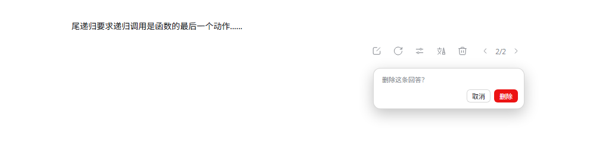

# dsh-message-toolbar

<p align="center">
  <strong>English</strong> · <a href="README.md">简体中文</a>
</p>

---

A message toolbar plugin for DSH (DeepSeek Harness).


---

## Features

| Action | Where | What happens |
| --- | --- | --- |
| **Edit** | user messages | Rewrites that question — drop files into the editor and they leave with it. |
| **Regenerate** | assistant messages | Answers again in place, without opening a new conversation. The fresh answer to the same question is stored as a variant of that turn and swapped in for the logged one. `‹ 1/2 ›` switches between them, and the count opens model names and short answer previews so you can jump straight to the one you want. |
| **Switch model** | assistant messages | Every model's answer becomes a variant of the same turn; `‹ 2/3 ›` walks them without leaving the conversation. |
| **Undo file edits** | before regenerate / switch model | Lists the files for confirmation and reverses only verifiable edits, preserving later changes outside the affected hunks. Conflicts or unverifiable files stop regeneration and report the outcome. |
| **Edit answer** | assistant messages | The answer becomes an editor where it stands, holding the markdown source of its text. |
| **Copy** | assistant messages | Once an answer has been replaced, edited or translated, the row carries a copy button of its own: it copies the answer on screen, while the app's copy button keeps copying the one in the log. |
| **Translate** | assistant messages | Pressing translate opens a dropdown of target languages; pick one and the answer is redrawn block by block, original and translation side by side. While it runs, the button becomes Stop translating. The same menu copies the translation on its own, or puts the answer back to the original. |
| **Delete message / answer** | user messages / assistant messages | Removes a whole turn (message, answer, tool cards, and the notices above the answer) or a single answer from the conversation. |
| **Version tree** | conversation view | A turn-level branching tree of the whole conversation family, with the active path highlighted, model labels, timestamps, and restore/delete controls. |

While editing a question, **files dropped into the editor** leave with it; the paperclip in its
corner picks them too, and so does **Ctrl+V** — a screenshot on the clipboard becomes an image
attachment instead of a wall of pasted text. They go through DSH's own upload route and land in the
same attachment store as anything you attach in the composer — images stay images.

The editor is not its own design: it is the composer's. Same surface and panel radius, the rail above
the text, pictures as 64px thumbnails and files as the app's 240×64 cards (type glyph, name, and a
`PDF 4.2KB` line), with the remove button appearing on hover exactly as it does up there. A question
that already carried attachments replays with them.

After sending, the question **shows its attachments above the bubble** — the position and the cards
the app uses for a question that carried them — because the plugin stored them
(`prompts[turn].files` in `~/.dsh/message-toolbar/state.json`) instead of keeping them in the
editor's short-lived state. They survive reloads and restarts on the same installation. Pending or failed uploads block sending.

## Limits

- DSH session logs are append-only, so "delete" hides rows in the view. Deleting a question also hides all its replayed answers.
- In-session regeneration still includes the earlier answer and repeated question in model history. This version does not implement request-scoped history isolation. The explicit new-answer-card action creates a child session instead; see the [reliability report](docs/RELIABILITY-2026-11-21.md).
- The answer ring only selects the displayed alternative; it does not change the model context path for the next question. This differs from Cherry's active branch semantics; see the [source comparison](docs/cherry-studio-comparison.md).
- Model switching uses the host's native selection. An explicit model-switch replay restores the prior selection after its matching turn ends (successfully, with an error, or by cancellation). A newer model choice made during the replay is preserved.
- Answer edits, grouping, attachment references and translations live in `~/.dsh/message-toolbar/state.json`; real regenerated answers remain in the session log. Moving machines requires both plugin state and the DSH attachment store.
- Undoing depends on the `workspace-changes` record: without a git repository it only covers file-tool edits, and after a host restart older turns have no record.
- The host diff normalizes the final newline. Without exact snapshots, nonempty created/deleted files may be skipped rather than restored unsafely. Binary and oversized files are skipped too. Other safe files may already have been reverted; the UI reports counts and stops regeneration.
- Preflight, revalidation and rollback reduce risk but do not make filesystem operations transactional. Process death, storage faults and concurrent path changes can defeat rollback; errors expose retained recovery backup paths.
- State persistence uses an exclusive sibling lock, latest-state delta merging and atomic replacement, so multiple DSH processes can write the same state file. Lock timeouts and corrupt or future-schema state are reported and the original file is preserved. Network filesystems and hostile external writers are outside the guarantee.
- Locks are reclaimed only when their recorded owner has exited. Unknown or corrupt ownership metadata causes a conservative timeout. The state directory must support hard links; a process killed during a short cleanup window can leave a guard requiring inspection after the relevant DSH processes have been stopped.

## Cherry toolbar follow-up in 1.10.0

Compared with Cherry Studio's message toolbar, this release adds cancellable streaming translation: cancel reaches the HTTP request and the DSH provider signal, so partial text is never persisted; answer choices show the model and a short preview; clipboard success is awaited and failures are reported. Structured DSH error/aborted finishes are no longer treated as successful answers.

## Reliability follow-up in 1.9.1

Building on the 1.9.0 reliability refactor, this release restores the prior model after an explicit model-switch replay ends, including a claimed replay that fails before its user message is recorded. Restore errors are logged and contained so an asynchronous failure cannot escape and crash the host. Shared state writes use a cross-process lock, latest-state merge and stale-lock recovery. Concurrent answer deletion and replay preserve the still-visible original answer, while other concurrent fields, alternatives and translations are retained. `npm test` builds the current client and runs existing checks plus new regressions. Validation uses isolated state, temporary files and a client VM; real GUI and model-call acceptance testing remains outstanding.

## Screenshots

| | |
| --- | --- |
|  |  |
| **Translate.** Original and translation, block by block. | **Edit an answer.** The answer turns into an editor where it stands, holding its markdown source. |
|  |  |
| **Delete.** | **A failed answer** gets a toolbar too: regenerate, another model, delete. |

## Requirements

- DSH `0.2.0-rc.2` … `0.2.x`

## Install

From a checkout:

```bash
git clone https://github.com/VicissitudeYW/dsh-message-toolbar.git
cd dsh-message-toolbar
npm run build                 # regenerates lib/client.js from plugin.client.js
dsh plugin --profile web add file:$(pwd)
```

Or from a packed tarball:

```bash
npm pack
dsh plugin --profile web add file:./dsh-message-toolbar-1.10.0.tgz
```

Then restart DSH — host and client both load at startup.

## License

MIT
