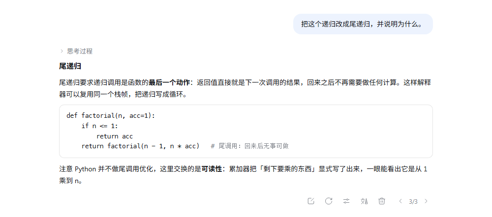
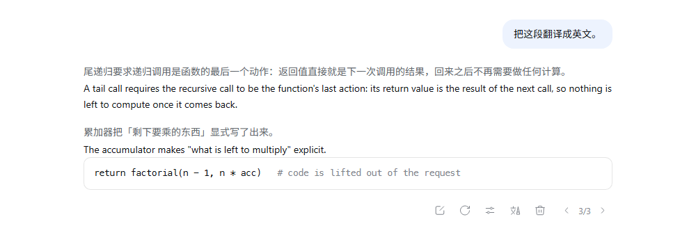
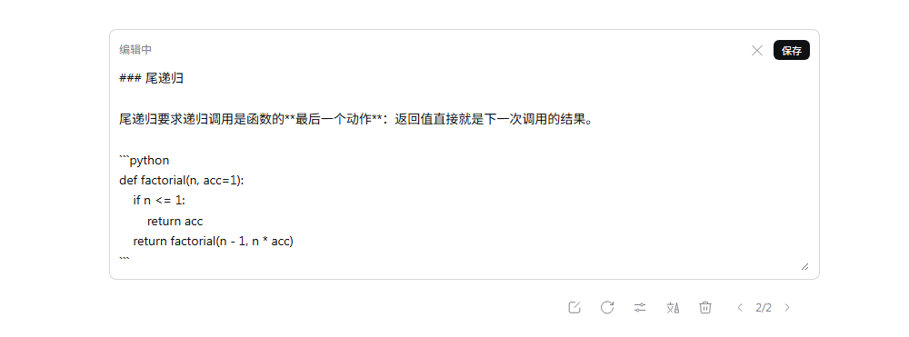
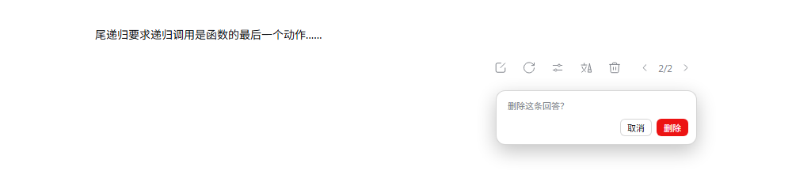

# dsh-message-toolbar

[简体中文](README.md) · **English**

[](LICENSE)
[](https://github.com/deepseek-ai/dsh)
[](test)

A message toolbar plugin for DSH (DeepSeek Harness).



---

## Features

| Action | Where | What happens |
| --- | --- | --- |
| **Edit** | user messages | Rewrites the turn in place: the conversation is rewound to just before that turn, a new child session is seeded with the edit, and the answer is regenerated. The original branch is preserved as a version card. |
| **Regenerate** | assistant messages | Answers again in place, without opening a new conversation. The fresh answer to the same question is stored as a variant of that turn and swapped in for the logged one. The `‹ 1/2 ›` control lives in the action row of that turn, next to delete. |
| **Switch model** | assistant messages | The same mechanism with another provider/model: every model's answer becomes a variant of the *same* turn, and `‹ 2/3 ›` walks them without leaving the conversation. The picker is DSH's own dropdown (the one under the composer), so it looks and keys exactly like the rest of the app; its last row instead opens a real branch, for a full run with tools. |
| **Undo file edits** | before regenerate / switch model | If the answer being replaced edited files, the row lists them and asks first. Confirming puts every file back the way it was before that answer and answers again — regenerate runs a real agent (tools, native streaming); switching a model instead adds the new answer to the `‹ 1/3 ›` ring. A single file that no longer matches leaves everything untouched, and tells you which ones moved on. |
| **Edit answer** | assistant messages & answer card | The pencil turns the answer into an editor *where the answer stands*: a bordered box holding the markdown source of its text. |
| **Translate** | assistant answers | Pressing translate opens a dropdown of target languages; pick one and the answer is redrawn bilingual, block by block. |
| **Questions render as markdown** | your own messages | The same renderer an answer uses, so `$…$` formulas, inline code and bold come out drawn (stock DSH paints user text as plain text). |
| **Delete** | version cards | Soft-deletes a version: the card is hidden from the ring and the version tree, but the session log is untouched and it can be restored. The root conversation can never be deleted. |
| **Delete message / answer** | user bubbles & assistant answers | Removes a whole turn (message, answer, tool cards) or a single answer from the conversation — handy for clearing the string of "continue" prompts left behind by a stuck turn. |
| **Version ring** | `‹ 2/3 ›` chip | Walks the answer variants of a turn (`1` is always the model's logged answer) and the sibling versions of a turn, without leaving the conversation. |
| **Version tree** | conversation view | A turn-level branching tree of the whole conversation family, with the active path highlighted, model labels, timestamps, and restore/delete controls. |


> Undoing uses DSH's own `workspace-changes` record (git snapshots plus a copy of each
> file before the file tools touch it), so the plugin stores no history of its own. That
> record lives as long as the host process that made it: after a restart the older turns
> have none, and the button simply answers again without undoing anything.

## How it relates to the other editing plugins

`dsh-message-toolbar` folds two earlier ideas into one plugin: the branching and version tree of
`SpookySandwich/dsh-plugin-message-edit`, and the "rewrite this turn in place" approach of
`moton16/dsh-msg-edit` — plus the everyday Cherry Studio operations (copy, regenerate, switch model,
bilingual translation, delete, edit an answer) and markdown rendering for the questions themselves.

Both of those plugins shadow the same chat rows through `conversation.chat.node` (the user bubble and
the assistant action row), so **do not run them next to this one**: remove them from the profile first.

## Known limits

- A variant answer is a plain completion (one `llm.stream`, no tool loop). A real run with tools only
  happens through two doors: `answer-run` after confirming the undo of file edits, or the last row of
  the model picker, "…or open a new branch".
- The session log is append-only, so "delete" hides rows in the view; the plugin removes no events, and
  the model still sees that message in later turns.
- Variants and translations live in `~/.dsh/message-toolbar/state.json`, not in the session log, so they
  do not travel with the conversation to another machine.
- Undoing depends on the `workspace-changes` record: without a git repository it only covers file-tool
  edits, and after a host restart older turns have no record at all.

## Screenshots

| | |
| --- | --- |
|  |  |
| **Translate.** Original and translation, block by block. | **Edit an answer.** The pencil turns the answer into an editor where it stands, holding its markdown source. |
|  |  |
| **Delete.** | **A failed answer** gets a toolbar too: regenerate, another model, delete. |

## Requirements

- DSH `0.2.0-rc.2` … `0.2.x`

## Install

From a checkout:

```bash
git clone https://github.com/<you>/dsh-message-toolbar.git
cd dsh-message-toolbar
npm run build                 # regenerates lib/client.js from plugin.client.js
dsh plugin --profile web add file:$(pwd)
```

Or from a packed tarball:

```bash
npm pack
dsh plugin --profile web add file:./dsh-message-toolbar-1.0.0.tgz
```

Then restart DSH — host and client both load at startup.

Implementation notes, the HTTP contract and the slot table are in
[docs/ARCHITECTURE.md](docs/ARCHITECTURE.md).

## License

MIT
