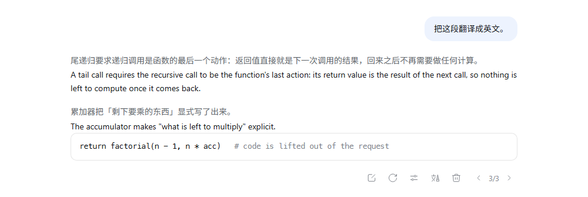

# dsh-message-toolbar

<p align="center">
  A Cherry Studio-style message toolbar for DSH
  <br>
  <strong>English</strong> · <a href="README.md">简体中文</a>
</p>

[](LICENSE)
[](package.json)

Add answer switching, regeneration, model switching, editing, translation, copy and delete actions below DSH messages.


## Install

Works with DSH `0.2.x` (minimum `0.2.2-rc.5`). Clone the repository and run:

```powershell
git clone https://github.com/VicissitudeYW/dsh-message-toolbar.git
cd dsh-message-toolbar
dsh plugin --profile web add file:$((Get-Location).Path)
```

On Bash, macOS or Linux:

```bash
git clone https://github.com/VicissitudeYW/dsh-message-toolbar.git
cd dsh-message-toolbar
dsh plugin --profile web add file:$(pwd)
```

Restart DSH after installing.

## Features

| Action | What it does |
| --- | --- |
| **Switch answers** | Move between answers to the same question. |
| **Regenerate** | Generate another answer for the current question. |
| **Switch model** | Generate an answer with another model. |
| **Edit a question** | Save a revised question or send it with attachments. |
| **Edit an answer** | Edit the answer's Markdown where it appears. |
| **Translate and copy** | Show a translation and copy either version. |
| **Delete and restore** | Remove a question or answer while keeping the old version available. |
| **Undo file changes** | Undo safe file changes made by an answer before regenerating or switching models. |

## Usage

1. Open a DSH conversation and find the toolbar below a message.
2. Use the arrows to switch answers; click the number to view the other answers.
3. Use Regenerate or Switch model for a new answer. Use Edit to change a question.
4. Saving an edited question only saves the change. Press Send to generate an answer.
5. Open the version tree to view or restore an older version.



## What to know

- Switching answers also switches the context for the next question. The next question continues from the answer you selected.
- Editing or deleting an earlier question or answer creates a new branch; the old version remains in the version tree.
- The old session records remain available, and branches use additional session storage.
- Some old histories cannot be edited when compaction or replacement makes their boundaries unclear. The plugin refuses those operations.
- File undo only reverts changes that DSH can verify. Uncertain files are left in place.

For bugs and suggestions, open an [Issue](https://github.com/VicissitudeYW/dsh-message-toolbar/issues).

## License

[MIT](LICENSE)
