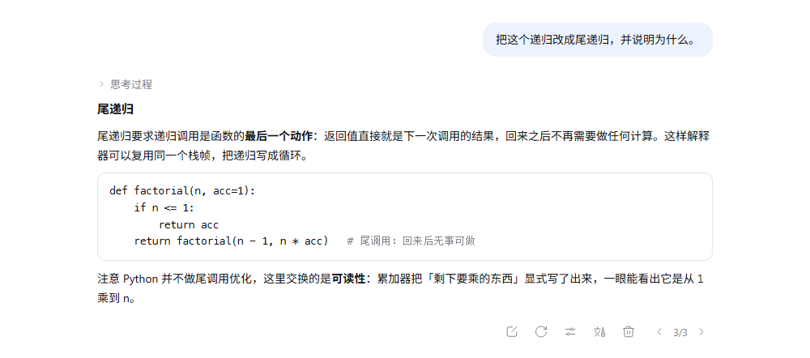

# dsh-message-toolbar

A Cherry Studio-style toolbar for [DeepSeek Harness](https://github.com/deepseek-ai/deepseek-harness). Regenerate, switch models, edit, translate, and **pick an answer to continue from**, right below your messages.

**English** · [简体中文](README.md) · [](LICENSE)

## Install

Works with DSH Desktop and Web from `0.2.2-rc.5` through `0.2.x`. Check that `dsh --version` runs in your terminal first.

**Windows Desktop (PowerShell)**

```powershell
git clone https://github.com/VicissitudeYW/dsh-message-toolbar.git
cd dsh-message-toolbar
dsh plugin --profile desktop add "file:$($PWD.Path.Replace('\', '/'))"
```

<details>
<summary>Web or Bash</summary>

```bash
git clone https://github.com/VicissitudeYW/dsh-message-toolbar.git
cd dsh-message-toolbar
dsh plugin --profile web add "file:$(pwd)"
```

Use `--profile desktop` for Desktop in Bash, or `--profile web` for Web in PowerShell. If you start DSH with a custom profile, use that name instead.

</details>

Restart DSH after installing. The toolbar appears below your messages.



## Usage

- **Pick an answer and keep chatting.** Use the arrows below an answer, or click the number to choose a version. Your next question uses that answer and its conversation history.
- **Revise the conversation.** Regenerate, switch models, or edit and delete messages. When editing a question, **Save** keeps the edit and **Send** generates a reply. Open the version tree to return to an earlier version.
- **Translate and copy.** Read the translation alongside the original and copy either one.


**Exploration cards:** With `dsh-btw-explore 0.3.4` or later, toolbar `1.11.1` and later save edits and switch answers inside the card, keeping its source excerpt. Closing or switching cards during a save leaves the main chat where it was.

## FAQ

**How do I continue a conversation changed with an older toolbar?** Open it as usual. The toolbar syncs your selected answers and message changes while keeping the original. If the synced version is archived, choose **Unarchive and open**. Choose **Retry sync** if syncing fails.

**Does regenerating or switching answers archive my chat?** Starting in `1.11.3`, the toolbar leaves archiving to you. DSH may show each version in the sidebar. You can switch versions or reopen an archived version from the version tree.

For bugs and suggestions, open an [issue](https://github.com/VicissitudeYW/dsh-message-toolbar/issues).

## License

[MIT](LICENSE)
