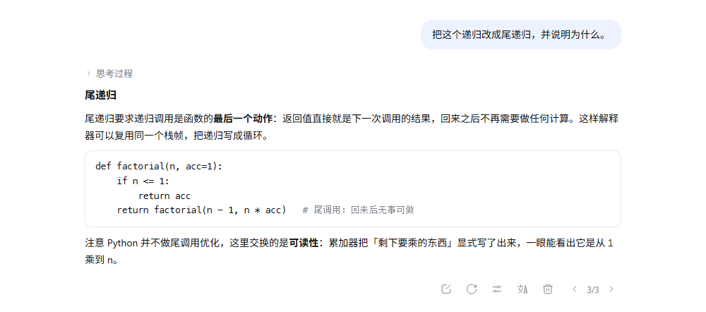
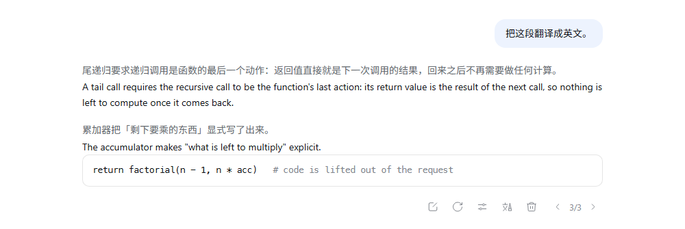
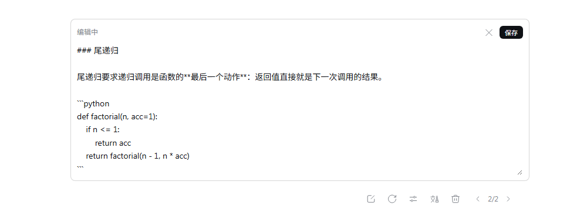
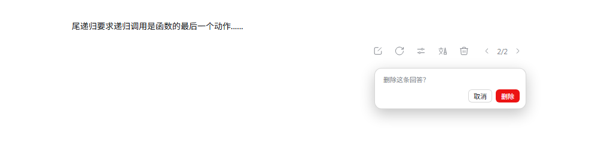

# dsh-message-toolbar

<p align="center">
  <strong>简体中文</strong> · <a href="README.en.md">English</a>
</p>

---


DSH（DeepSeek Harness）消息工具栏插件。



---

## 功能

| 操作 | 位置 | 效果 |
| --- | --- | --- |
| **编辑** | 用户消息 | 修改这条提问；也可以把文件直接拖进编辑框，和改写后的文字一起发出去。 |
| **重新生成** | 助手消息 | 就地重答，不新开对话。同一个问题的新回答存成这一轮的一个「备选」，直接替换显示。显示切换按钮 `‹ 1/2 ›` ，点中间的计数可以按模型名直接跳到某一份回答。 |
| **切换模型** | 助手消息 | 每个模型的回答都是同一轮的备选，`‹ 2/3 ›` 就地来回切换，不离开当前对话 |
| **回退文件改动** | 重新生成 / 切换模型之前 | 被替换的那条回答如果改过文件，会先列出这些文件问一句；确认后把文件恢复成回答之前的样子，切换模型则在此基础上把新回答加进 `‹ 1/3 ›` 里。 |
| **编辑回答** | 助手消息 | 在回答原来的位置变成编辑器，显示这条回答的 markdown 源码。 |
| **复制** | 助手消息 | 回答被换过、编辑过或翻译过之后，行上会多一个复制按钮——复制的是屏幕上这条回答（原生复制按钮复制的是日志里那条）。 |
| **翻译** | 助手消息 | 点翻译直接弹出语言下拉，选一种语言，回答按段对照；菜单里还能单独「复制译文」或收起译文。 |
| **删除消息 / 回答** | 用户消息 / 助手消息 | 把某一轮（消息、回答、工具卡片）或单独一条回答从对话里删掉。 |
| **版本树** | 会话视图 | 整个会话家族的逐轮分支树，高亮当前路径，带模型标签、时间以及恢复/删除按钮。 |

编辑提问时，**把文件拖进编辑框**就会跟这条提问一起发出去，也可以在编辑框右上角点附件按钮挑文件，
或者直接 **Ctrl+V 粘贴**——截图工具复制到剪贴板的图片会当成一张图片附件上传，不会变成一段文字。
文件走的是 DSH 自己的上传接口，落到同一个附件库里，和你在输入框里附加一个文件完全一样（图片仍然
按图片处理）。编辑框不是另做一套外观：它就是输入框那一套——同样的底色与圆角，附件栏在文字上方，
图片是 64px 缩略图、文件是 240×64 的卡片（左边文件类型图标，右边文件名和 `PDF 4.2KB` 这样的说明），
删除按钮和输入框里一样只在悬停时出现。原来就带附件的提问，重新生成时会带着那些附件一起重放。

发送之后，这条提问的上方也会**照原样显示它的附件**——就是原生消息里附件那一行的位置和样式，
因为插件把它存下来了（`~/.dsh/message-toolbar/state.json` 里 `prompts[轮次].files`），
而不是只存在于编辑框的临时状态里。所以刷新页面、换机器重新打开，附件都还在。


## 限制
- DSH 的会话日志只追加、不重写，所以「删除」是视图层隐藏
- 变体与翻译存在 `~/.dsh/message-toolbar/state.json`，不写进会话日志；换机器不会跟着走。
- 回退依赖 `workspace-changes` 的记录：没有 git 仓库时只覆盖文件工具的改动，宿主重启后旧轮次没有记录。

## 功能展示

| | |
| --- | --- |
|  |  |
| **翻译。** 原文与译文按段对照 | **编辑回答。** 回答在**原来的位置**变成编辑器，里面是 markdown 源码 |
|  |  |
| **删除。** | **失败的回答**有工具栏：重新生成、换个模型、删除。 |

## 环境要求

- DSH `0.2.0-rc.2` … `0.2.x`

## 设计笔记

- [`docs/ARCHITECTURE.md`](./docs/ARCHITECTURE.md)：插槽、路由、状态、样式表的来龙去脉。
- [`docs/cherry-studio-comparison.md`](./docs/cherry-studio-comparison.md)：和 Cherry Studio 消息区的逐项对照，
  以及 1.7.0 那几处改动是照着哪一点改的。

## 安装

从仓库直接装：

```bash
git clone https://github.com/VicissitudeYW/dsh-message-toolbar.git
cd dsh-message-toolbar
npm run build                 # 从 plugin.client.js 重新生成 lib/client.js
dsh plugin --profile web add file:$(pwd)
```

或者用打好的包：

```bash
npm pack
dsh plugin --profile web add file:./dsh-message-toolbar-1.0.0.tgz
```

然后重启 DSH——宿主端和客户端都在启动时加载。

## 许可

MIT
